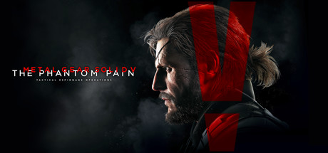

**Metal Gear Solid V: The Phantom Pain by Kojima Productions (2015) is Hideo Kojima's final Metal Gear.**

---

## 📖 About

Metal Gear Solid V: The Phantom Pain by Kojima Productions (2015) is Hideo Kojima's final Metal Gear. Big Boss builds Mother Base and wages covert war across Afghanistan and Africa. It is the series' deepest tactical stealth sandbox and its FOB (Forward Operating Base) invasion system remains uniquely stressful.

## ⚠️ Problems Without Trainer

| Problem | Status |
|---------|--------|
| S-rank mission requirements demand non-lethal, unseen, under-15-minute runs | ✅ Solved |
| Resource grinding for FOB defense equipment requires hundreds of infiltration replays | ✅ Solved |
| Staff fulton limits prevent capturing all high-ranked soldiers in one pass | ✅ Solved |
| Skulls parasite enemy encounters devastate runs without prior material preparation | ✅ Solved |
| Final Chapter 51 inaccessibility requires completing 99 percent of prior content | ✅ Solved |

## ✅ Solution

The **Metal Gear Solid V: The Phantom Pain Trainer** solves all these issues, giving you complete control so you can focus on enjoying the game.

## 🎯 Features

- Unlimited Resources / Currency
- God Mode / Invincibility
- Instant Skill & Ability Cooldown
- One-Hit Kill
- Freeze Timers
- Unlock All Items & Achievements
- Custom Speed Multiplier
- Infinite Stamina / Energy

## 🚀 Quick Start

1. **Disable Windows Defender** temporarily (trainer may trigger false positive)
2. Get the trainer from the button above
3. Launch Metal Gear Solid V: The Phantom Pain
4. Run the trainer as Administrator
5. Use the hotkeys to activate cheats in-game

## 💎 Free vs Pro

| Feature | Free | Pro |
|---------|------|-----|
| God Mode | ✅ | ✅ |
| Unlimited Resources | ✅ | ✅ |
| Advanced Cheats | ❌ | ✅ |
| Auto-Updates | ❌ | ✅ |
| Priority Support | ❌ | ✅ |

## 💻 Requirements

- Windows 10 / 11 (64-bit)
- Metal Gear Solid V: The Phantom Pain (any version)
- .NET Framework 4.8+
- DirectX 11+

## 🍎 macOS

## ⚖️ Legal

Educational and single-player use only.

---

